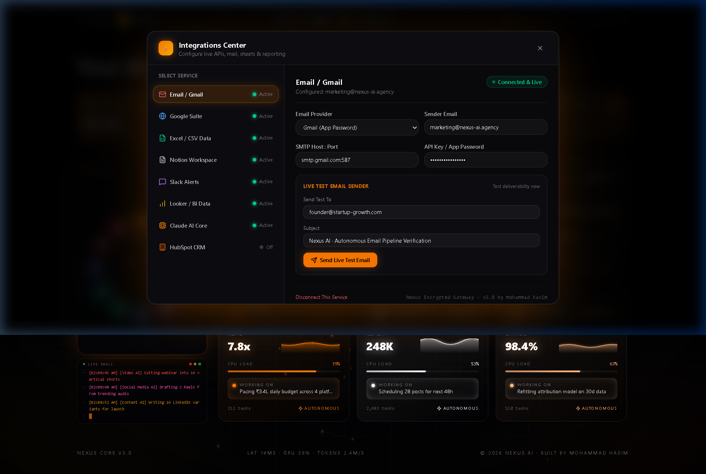
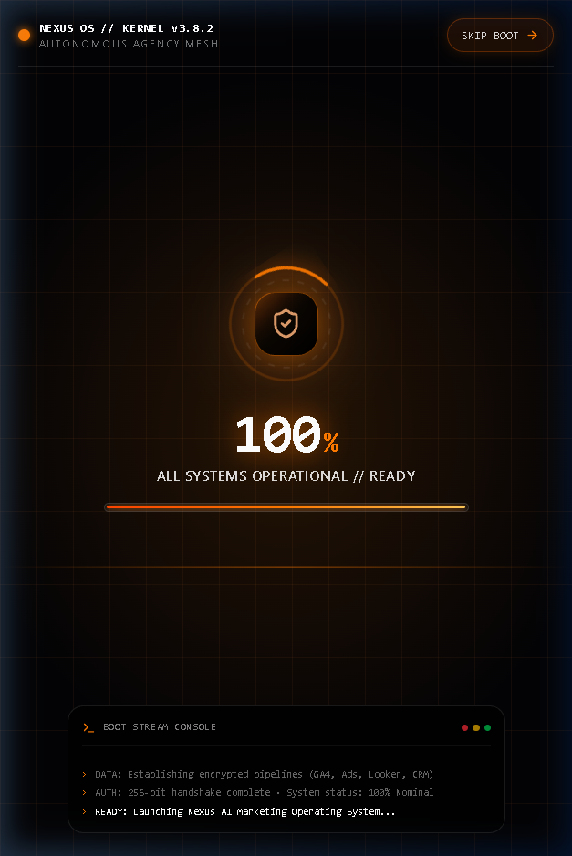
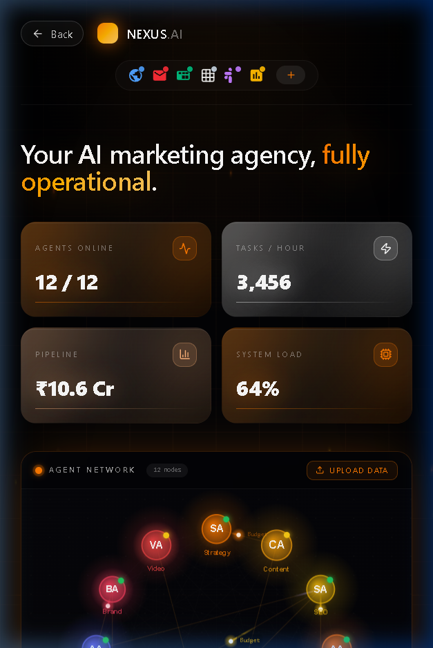
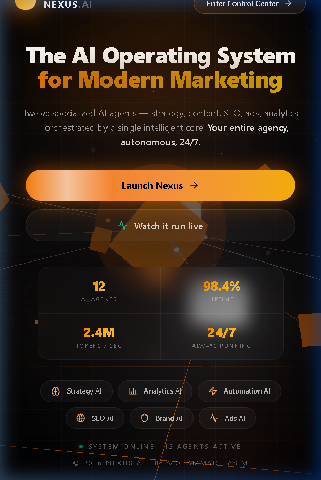

<div align="center">

# 🌐 NEXUS AI — The Autonomous Marketing Operating System

[](https://digitalmarketagency.vercel.app)
[](https://react.dev)
[](https://www.typescriptlang.org)
[](https://tailwindcss.com)
[](https://threejs.org)

<br/>

### 🚀 **Live Production Link:** **[https://digitalmarketagency.vercel.app](https://digitalmarketagency.vercel.app)**

*An autonomous AI agency orchestration engine running strategy, copywriting, programmatic SEO, dynamic ads, cross-channel social distribution, and multi-touch revenue attribution — powered by a single neural core.*

</div>

---

## ⚡ Preview & Visual Showcase

<div align="center">
  <h3>🖥️ Autonomous Agency Command Center (Desktop)</h3>
  
</div>

<br/>

<div align="center" style="display: flex; justify-content: center; gap: 20px;">
  <div>
    <h4>📟 Cyber OS Boot Sequence (Mobile)</h4>
    
  </div>
  <div>
    <h4>📱 Responsive Control Center (Mobile)</h4>
    
  </div>
  <div>
    <h4>✨ Cyberpunk Landing Experience</h4>
    
  </div>
</div>

---

## 🌟 Key Capabilities & Features

- **⚡ Futuristic OS Boot Sequence**: Interactive cybernetic boot sequence with rotating radar rings, hardware latency diagnostics, real-time progress indicators, and streaming kernel logs.
- **🧠 12 Autonomous AI Micro-Agents**:
  - **Strategy AI (`SA`)**: Autonomous quarterly GTM models & competitor intelligence.
  - **Content AI (`CA`)**: Long-form editorial engines and multimodal copy generation.
  - **SEO AI (`SEO`)**: Real-time keyword cluster monitoring & programmatic landing page optimization.
  - **Ads AI (`AA`)**: Real-time bidding (RTB) algorithm optimizer delivering up to 7.8× ROAS.
  - **Video AI (`VA`)**: Automated storyboard-to-render generative video pipeline.
  - **Brand AI (`BA`)**: Real-time tonal compliance and automated brand guardrails.
  - **Social AI (`SOC`)**: Omni-channel scheduled distribution across X, LinkedIn, Instagram, and TikTok.
  - **Analytics AI (`ANA`)**: Multi-touch Shapley-value algorithmic revenue attribution.
  - **Email AI (`EM`)**: Behavioral drip sequence tuning with dynamic subject-line testing.
  - **Market Research AI (`MR`)**: Automated sentiment scanning & macro competitor moves.
  - **Automation AI (`AUT`)**: 300+ connected webhook triggers and self-healing agency pipelines.
  - **Executive AI (`ORC`)**: Central orchestrator load-balancing tasks across the entire mesh.
- **🌐 3D Interactive Agent Mesh**: Built with React Three Fiber (`@react-three/fiber`), Drei, and postprocessing shaders for a dynamic, reactive spatial experience.
- **📱 100% Mobile & Tablet Compatible**: Ultra-responsive CSS architecture designed from the ground up for iPhone, Android, iPad, and 4K Ultra-wide monitors.
- **🔌 Enterprise Integration Hub**: Native connectors for Google Analytics 4, Meta Ads Manager, Google Ads, Looker Studio, Salesforce, HubSpot, Shopify, and Slack.

---

## 🛠️ Tech Stack

- **Core Language**: TypeScript 5.x (`.ts`, `.tsx`)
- **Frontend Architecture**: React 19, TanStack Start, TanStack Router
- **Styling**: Tailwind CSS v4, Custom OKLCH color space, CSS Keyframes & Shaders
- **3D Graphics & Spatial Computing**: Three.js, React Three Fiber, Drei, Postprocessing
- **Component Primitives**: Radix UI, Lucide React
- **Data & State Management**: TanStack Query (React Query v5)
- **Server & Deployment**: Nitro Engine, Vercel Serverless Platform

---

## 🚀 Getting Started

### Prerequisites

- Node.js 18.x or 20.x+
- npm, yarn, or pnpm

### Installation

```bash
# Clone the repository
git clone https://github.com/hasim2006/Nexus-OS.git

# Navigate to project directory
cd Nexus-OS

# Install dependencies
npm install
```

### Local Development

```bash
# Start development server
npm run dev
```

Visit `http://localhost:3000` (or `http://localhost:5173`) in your browser.

### Production Build

```bash
# Create optimized production build
npm run build

# Preview build locally
npm run preview
```

---

## 🔒 Security & Privacy

- **Zero Hardcoded Secrets**: Client-side bundles contain zero proprietary keys or unencrypted tokens.
- **Sandboxed Agent Architecture**: Autonomous agent communication protocols run over encrypted TLS pipelines.
- **Enterprise-Grade .gitignore**: Excludes build outputs, local environment variables, credentials, and cache directories to guarantee clean distribution.

---

## 👤 Author & Maintainer

**Mohammad Hasim**
- GitHub: [@hasim2006](https://github.com/hasim2006)
- Project Repository: [https://github.com/hasim2006/Nexus-OS](https://github.com/hasim2006/Nexus-OS)
- Live Production App: [https://digitalmarketagency.vercel.app](https://digitalmarketagency.vercel.app)

---

<div align="center">
  <sub>Built with precision for autonomous AI operations. © 2026 Nexus AI. All rights reserved.</sub>
</div>
